<picture><source media="(prefers-color-scheme: light)" srcset="https://raw.githubusercontent.com/luigimenezes13/luigimenezes13/refs/heads/stats/header-light.svg" /></picture>

Trabalho com backend na V4 Company, no time de Finance: cobrança, faturamento e folha.
Estudo Engenharia da Computação na PUC-Campinas. Meu TCC é um estudo de Engenharia de 
Software  com um artefato que lê placas de carro com um Raspberry Pi e mostra uma solução 
sustentável para um problema complexo, o topo desta página é ele lendo o meu nome.

No trabalho escrevo TypeScript. Nas horas livres, Go.

[LinkedIn](https://www.linkedin.com/in/luigi-b-943708141/) · [luigibertoli.menezes@gmail.com](mailto:luigibertoli.menezes@gmail.com)

### Estacionamento

<!-- parking:start -->
<picture><source media="(prefers-color-scheme: light)" srcset="assets/parking-light.svg" /></picture>

**Estacione na vaga** [01](https://github.com/luigimenezes13/luigimenezes13/issues/new?title=estacionar%7C01&body=S%C3%B3%20clicar%20em%20**Submit%20new%20issue**.%20Em%20cerca%20de%20um%20minuto%20seu%20carro%20aparece%20no%20perfil.) · [02](https://github.com/luigimenezes13/luigimenezes13/issues/new?title=estacionar%7C02&body=S%C3%B3%20clicar%20em%20**Submit%20new%20issue**.%20Em%20cerca%20de%20um%20minuto%20seu%20carro%20aparece%20no%20perfil.) · [03](https://github.com/luigimenezes13/luigimenezes13/issues/new?title=estacionar%7C03&body=S%C3%B3%20clicar%20em%20**Submit%20new%20issue**.%20Em%20cerca%20de%20um%20minuto%20seu%20carro%20aparece%20no%20perfil.) · [04](https://github.com/luigimenezes13/luigimenezes13/issues/new?title=estacionar%7C04&body=S%C3%B3%20clicar%20em%20**Submit%20new%20issue**.%20Em%20cerca%20de%20um%20minuto%20seu%20carro%20aparece%20no%20perfil.) · [05](https://github.com/luigimenezes13/luigimenezes13/issues/new?title=estacionar%7C05&body=S%C3%B3%20clicar%20em%20**Submit%20new%20issue**.%20Em%20cerca%20de%20um%20minuto%20seu%20carro%20aparece%20no%20perfil.) · [07](https://github.com/luigimenezes13/luigimenezes13/issues/new?title=estacionar%7C07&body=S%C3%B3%20clicar%20em%20**Submit%20new%20issue**.%20Em%20cerca%20de%20um%20minuto%20seu%20carro%20aparece%20no%20perfil.) · [08](https://github.com/luigimenezes13/luigimenezes13/issues/new?title=estacionar%7C08&body=S%C3%B3%20clicar%20em%20**Submit%20new%20issue**.%20Em%20cerca%20de%20um%20minuto%20seu%20carro%20aparece%20no%20perfil.) · [09](https://github.com/luigimenezes13/luigimenezes13/issues/new?title=estacionar%7C09&body=S%C3%B3%20clicar%20em%20**Submit%20new%20issue**.%20Em%20cerca%20de%20um%20minuto%20seu%20carro%20aparece%20no%20perfil.) · [10](https://github.com/luigimenezes13/luigimenezes13/issues/new?title=estacionar%7C10&body=S%C3%B3%20clicar%20em%20**Submit%20new%20issue**.%20Em%20cerca%20de%20um%20minuto%20seu%20carro%20aparece%20no%20perfil.) · [11](https://github.com/luigimenezes13/luigimenezes13/issues/new?title=estacionar%7C11&body=S%C3%B3%20clicar%20em%20**Submit%20new%20issue**.%20Em%20cerca%20de%20um%20minuto%20seu%20carro%20aparece%20no%20perfil.) · [12](https://github.com/luigimenezes13/luigimenezes13/issues/new?title=estacionar%7C12&body=S%C3%B3%20clicar%20em%20**Submit%20new%20issue**.%20Em%20cerca%20de%20um%20minuto%20seu%20carro%20aparece%20no%20perfil.) · [13](https://github.com/luigimenezes13/luigimenezes13/issues/new?title=estacionar%7C13&body=S%C3%B3%20clicar%20em%20**Submit%20new%20issue**.%20Em%20cerca%20de%20um%20minuto%20seu%20carro%20aparece%20no%20perfil.) · [14](https://github.com/luigimenezes13/luigimenezes13/issues/new?title=estacionar%7C14&body=S%C3%B3%20clicar%20em%20**Submit%20new%20issue**.%20Em%20cerca%20de%20um%20minuto%20seu%20carro%20aparece%20no%20perfil.) · [15](https://github.com/luigimenezes13/luigimenezes13/issues/new?title=estacionar%7C15&body=S%C3%B3%20clicar%20em%20**Submit%20new%20issue**.%20Em%20cerca%20de%20um%20minuto%20seu%20carro%20aparece%20no%20perfil.) · [16](https://github.com/luigimenezes13/luigimenezes13/issues/new?title=estacionar%7C16&body=S%C3%B3%20clicar%20em%20**Submit%20new%20issue**.%20Em%20cerca%20de%20um%20minuto%20seu%20carro%20aparece%20no%20perfil.)
<!-- parking:end -->

### Projetos

  <a href="https://github.com/luigimenezes13/OpenFinance"><picture><source media="(prefers-color-scheme: light)" srcset="https://raw.githubusercontent.com/luigimenezes13/luigimenezes13/refs/heads/stats/projects/OpenFinance-light.svg" /></picture></a>
  <a href="https://github.com/luigimenezes13/lpr-microservice"><picture><source media="(prefers-color-scheme: light)" srcset="https://raw.githubusercontent.com/luigimenezes13/luigimenezes13/refs/heads/stats/projects/lpr-microservice-light.svg" /></picture></a>

  <a href="https://github.com/luigimenezes13/parking"><picture><source media="(prefers-color-scheme: light)" srcset="https://raw.githubusercontent.com/luigimenezes13/luigimenezes13/refs/heads/stats/projects/parking-light.svg" /></picture></a>
  <a href="https://github.com/luigimenezes13/trainees"><picture><source media="(prefers-color-scheme: light)" srcset="https://raw.githubusercontent.com/luigimenezes13/luigimenezes13/refs/heads/stats/projects/trainees-light.svg" /></picture></a>

  <a href="https://github.com/luigimenezes13/go-katas"><picture><source media="(prefers-color-scheme: light)" srcset="https://raw.githubusercontent.com/luigimenezes13/luigimenezes13/refs/heads/stats/projects/go-katas-light.svg" /></picture></a>
  <a href="https://github.com/luigimenezes13/portfolio-dossie"><picture><source media="(prefers-color-scheme: light)" srcset="https://raw.githubusercontent.com/luigimenezes13/luigimenezes13/refs/heads/stats/projects/portfolio-dossie-light.svg" /></picture></a>

### Números

  <picture><source media="(prefers-color-scheme: light)" srcset="https://raw.githubusercontent.com/luigimenezes13/luigimenezes13/refs/heads/stats/stats-light.svg" /></picture>
  <picture><source media="(prefers-color-scheme: light)" srcset="https://raw.githubusercontent.com/luigimenezes13/luigimenezes13/refs/heads/stats/languages-light.svg" /></picture>

  <picture><source media="(prefers-color-scheme: light)" srcset="https://raw.githubusercontent.com/luigimenezes13/luigimenezes13/refs/heads/stats/merge-time-light.svg" /></picture>
  <picture><source media="(prefers-color-scheme: light)" srcset="https://raw.githubusercontent.com/luigimenezes13/luigimenezes13/refs/heads/stats/productive-time-light.svg" /></picture>

  <picture><source media="(prefers-color-scheme: light)" srcset="https://raw.githubusercontent.com/luigimenezes13/luigimenezes13/refs/heads/stats/contributions-light.svg" /></picture>

